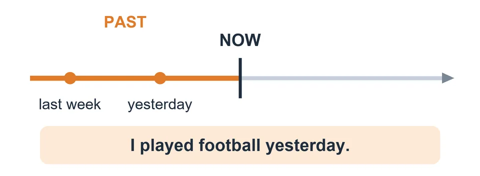

# Past simple: regular verbs

## Think first

What did you do yesterday after you woke up? Say one thing out loud.

## When do we use the past simple?

We use the **past simple** for things that happened **before now** and are finished.

These time words tell you a sentence is about the past:

- yesterday
- last week, last month, last year
- two days ago
- on Sunday (the Sunday that has gone)

## Regular verbs: add -ed

Most verbs are **regular**. To make the past simple, add **-ed**.

- play becomes **played**
- help becomes **helped**
- walk becomes **walked**
- clean becomes **cleaned**

Examples:

- I **visited** my aunt in Nyamata on Saturday.
- We **cleaned** the classroom yesterday.
- She **helped** her mother in the garden last week.

## Three spelling rules

- The verb ends in **e**: add only **-d**. Live becomes **lived**. Dance becomes **danced**.
- The verb ends in a consonant and **y**: change y to **-ied**. Study becomes **studied**. Carry becomes **carried**.
- A short verb ends in one vowel and one consonant: double the last letter. Stop becomes **stopped**. Plan becomes **planned**.

Be careful: play becomes **played**, not plaied, because there is a vowel before the y.

## After "did" and "did not"

After **did** or **did not**, use the plain verb with no -ed.

- She **did not play** football yesterday.
- **Did** you **help** your father?

## Example

Put the verb in the past simple: Yesterday I (wash) my uniform.

- Wash is a regular verb.
- Add -ed: washed.
- Yesterday I **washed** my uniform.

## Try it

- Last night we (watch) a football match. Hint: add -ed.
- She (study) English last year. Hint: the verb ends in a consonant and y.

Check your answers: watched, studied.

## Think back

Tell a friend two things you did last weekend. Use two verbs that end in -ed.
