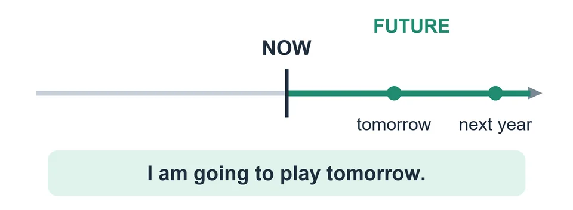

# Future plans: going to, want to, would like to

## Think first

What do you want to be when you grow up?

## Talking about the future

The future is the time that has not come yet. These time words tell you a sentence is about the future:

- tomorrow
- next week, next month, next year
- in the future
- when I grow up

Today you will learn three ways to talk about plans and wishes.

## Going to

Use **going to** for a plan you have already decided.

Build it like this: **am, is or are** and then **going to** and then the plain verb.

- I **am going to** study hard.
- She **is going to** visit her aunt tomorrow.
- They **are going to** plant trees next Saturday.

Do not forget am, is or are. "I going to study" is wrong.

## Want to

Use **want to** for something you wish for strongly.

- I **want to** build a house for my parents.
- We **want to** win the match.

With he, she or it, add **s**: He **wants to** become a teacher.

## Would like to

Use **would like to** for a wish, in a polite and gentle way. It stays the same for every person.

- I **would like to** be a nurse.
- She **would like to** learn French.

## The verb after "to"

After **going to**, **want to** and **would like to**, always use the plain verb.

- Correct: I am going to **visit** my uncle.
- Wrong: I am going to visited my uncle.

## Example

Make a sentence: she, going to, cook rice, tonight.

- She goes with **is**.
- She **is going to cook** rice tonight.

## Try it

- We (going to) clean the school compound tomorrow. Hint: we goes with are.
- He (want to) be a doctor. Hint: he needs an s.

Check your answers: We are going to clean. He wants to be.

## Think back

Say three of your own plans. Use going to, want to and would like to.
