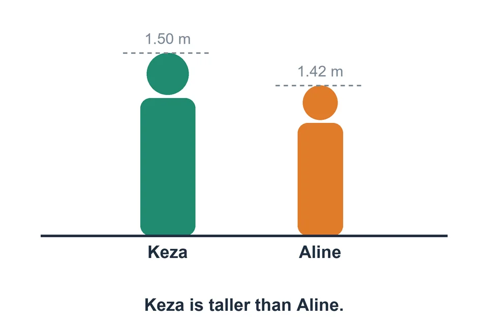

# Comparing two things: -er than

## Think first

Who is taller, you or your best friend?

## Comparative adjectives

An **adjective** is a describing word: tall, big, cheap, fast.

To compare **two** people, places or things, we use the **comparative**. For short adjectives, add **-er** and then use the word **than**.

- tall becomes **taller**
- long becomes **longer**
- deep becomes **deeper**
- high becomes **higher**
- cheap becomes **cheaper**
- fast becomes **faster**

Examples:

- A bus is **bigger than** a motorbike.
- Lake Kivu is **deeper than** Lake Muhazi.
- My brother is **taller than** me.

## Three spelling rules

- The adjective ends in **e**: add only **-r**. Wide becomes **wider**. Large becomes **larger**.
- A short adjective ends in one vowel and one consonant: double the last letter. Big becomes **bigger**. Hot becomes **hotter**. Thin becomes **thinner**.
- The adjective ends in a consonant and **y**: change y to **-ier**. Heavy becomes **heavier**. Easy becomes **easier**.

## Two mistakes to avoid

- Do not forget **than**. "A bus is bigger a motorbike" is wrong.
- Do not use more with -er. "More taller" is wrong. Say **taller**.

## Example

Compare: a goat, a cow, heavy.

- Heavy ends in a consonant and y, so it becomes heavier.
- A cow is **heavier than** a goat.

## Try it

- A bicycle is (cheap) than a car. Hint: add -er.
- The market is (wide) than the bridge. Hint: wide already ends in e.

Check your answers: cheaper, wider.

## Think back

Compare two things in the room where you are now. Use -er and than.
