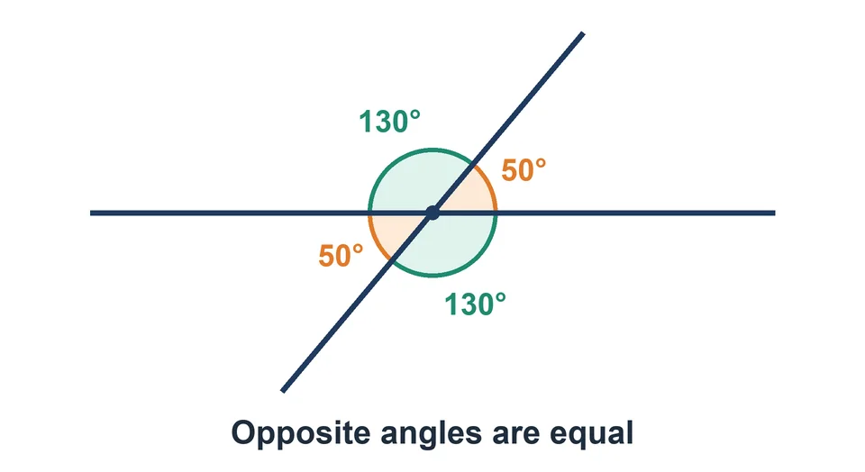

# Angles where lines cross

## Think first

Look at the letter X. Two lines cross each other. How many angles can you count?

## Perpendicular lines

Lines that meet at **90°** are called **perpendicular lines**. A wall and the floor are perpendicular. So are the two edges at the corner of your exercise book.

Two angles that add up to 90° are called **complementary angles**. Example: 30° and 60°.

## Angles on a straight line

Angles that sit next to each other on a straight line add up to **180°**. They are called **supplementary angles**.

If one angle is 130°, the other is 180 - 130 = 50°.

## Angles at a point

All the angles that go round one point add up to **360°**. That is one full turn.

## Opposite angles

When two straight lines cross, they make four angles. The angles that face each other are called **opposite angles**. Opposite angles are **equal**.

## Example

Two lines cross. One angle is 50°. Find the other three.

- The opposite angle is equal, so it is 50°.
- The angle next to it is on the same straight line: 180 - 50 = 130°.
- The last angle is opposite the 130°, so it is 130°.
- Check: 50 + 130 + 50 + 130 = 360. Correct.

## Try it

- Two angles are on a straight line. One is 110°. Find the other. Hint: take it away from 180.
- Three angles meet at a point. Two of them are 100° and 120°. Find the third. Hint: all three add up to 360.

Check your answers: 70° and 140°.

## Think back

Which rule was new for you today: 90, 180 or 360?
