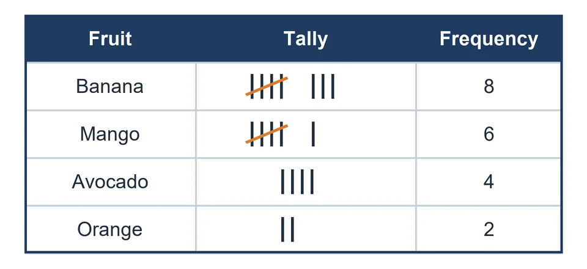
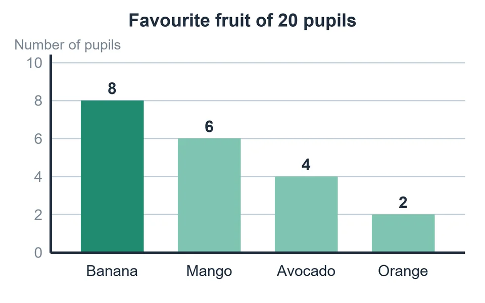

# Tally charts and bar charts

## Think first

You want to know which fruit your classmates like best. How can you keep count while they call out their answers?

## Tally marks

A **tally mark** is one small stroke for each answer. For every fifth answer, draw the stroke **across** the four before it. This makes a bundle of 5.

Bundles make counting quick. Count the bundles in fives, then add the strokes that are left.

- Two bundles and three strokes: 5 + 5 + 3 = 13

The total for each group is called the **frequency**. Frequency means how many times.

## Example: favourite fruit

Twenty pupils chose their favourite fruit. After counting the tally marks, the frequencies are:

- Banana: 8
- Mango: 6
- Avocado: 4
- Orange: 2

Check the total: 8 + 6 + 4 + 2 = 20. All twenty pupils are counted.

## Drawing a bar chart

A **bar chart** shows the frequencies as bars.

- First, draw two lines: one along the bottom and one up the side.
- Then, write the groups along the bottom: banana, mango, avocado, orange.
- Then, write numbers up the side. Start at 0 and go up in equal steps.
- Draw one bar for each group. The **height** of the bar is the frequency.
- Make every bar the same width, and leave a gap between bars.
- Last, give the chart a title and label both lines.

## Reading a bar chart

- The tallest bar is the group with the most. Here it is banana.
- The shortest bar is the group with the least. Here it is orange.
- To compare two bars, subtract. Banana and orange: 8 - 2 = 6 more pupils chose banana.

## Try it

Use the fruit data above.

- How many pupils chose mango or avocado? Hint: add the two frequencies.
- How many more pupils chose mango than orange? Hint: subtract.

Check your answers: 10 and 4.

## Think back

What would you like to count with a tally chart this week?
