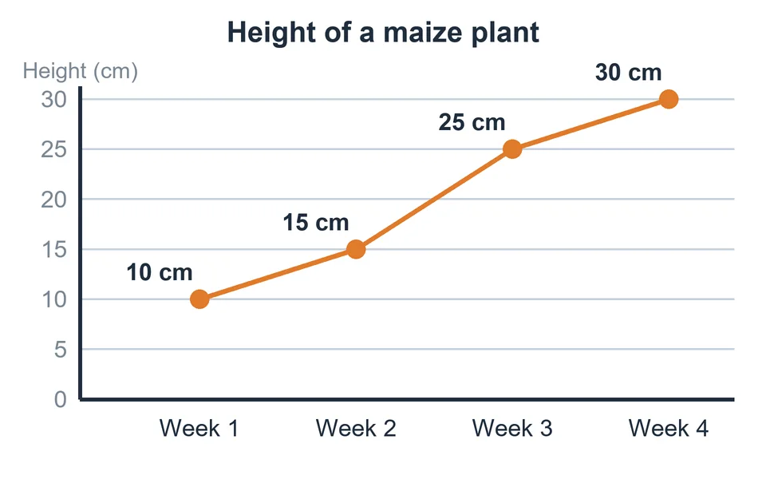

# Line graphs

## Think first

Is it hotter at 8 in the morning or at midday? How could you show that change on paper?

## What is a line graph?

A **line graph** shows how something **changes over time**. A bar chart compares groups. A line graph follows one thing as time passes.

- Time goes along the bottom: hours, days, weeks or months.
- The value you measure goes up the side: centimetres, degrees, francs.

## Drawing a line graph

- First, draw the two lines and label them.
- Then, write the times along the bottom and the numbers up the side. Start at 0 and go up in equal steps.
- Mark one point for each time.
- Last, join the points in order with straight lines.

## Reading a line graph

- The line goes **up**: the value is rising.
- The line goes **down**: the value is falling.
- The line is **flat**: nothing changed.
- The steepest part shows the biggest change.

## Example: a maize plant

A pupil measured a maize plant every week.

- Week 1: 10 cm
- Week 2: 15 cm
- Week 3: 25 cm
- Week 4: 30 cm

The line goes up every week, so the plant is always growing.

How much did it grow from week 2 to week 3? 25 - 15 = 10 cm. That is the biggest jump, so that part of the line is the steepest.

How much did it grow altogether? 30 - 10 = 20 cm.

## Try it

Use the maize data above.

- How much did the plant grow from week 3 to week 4? Hint: subtract the two heights.
- In which week was the plant 15 cm tall?

Check your answers: 5 cm, and week 2.

## Think back

What changes every day that you could measure and show on a line graph?
