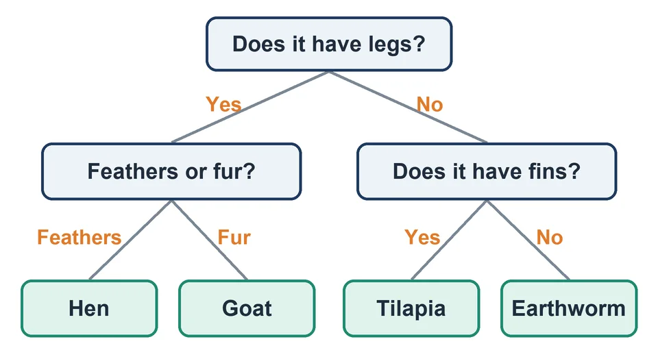

# Why we classify, and how to use a key

## Think first

In a market, why are tomatoes sold in one place and clothes in another?

## So many living things

Rwanda has thousands of different kinds of plants and hundreds of different kinds of animals. The whole Earth has millions. Nobody can study them one by one without some order.

## What is classification?

**Classification** means sorting living things into groups. We put organisms together when they share features, and we separate them when they are different. The science of classifying organisms is called **taxonomy**.

You already classify. When you say "that is an animal" and "that is a plant", you are sorting by features: the animal moves about and eats other organisms, and the plant is green and stays in one place.

## Why do scientists classify?

- It makes organisms easier to **identify**.
- It makes them easier to **study**, because organisms in one group are alike.
- It lets scientists everywhere **share** what they find.

Scientists sometimes move an organism to a different group when they learn more about it.

## Identification keys

A **key** helps you to name an organism you do not know. A **dichotomous key** is a list of steps. Each step gives **two** statements. You choose the one that fits your organism and follow where it sends you. "Di" means two.

## Example

Here is a key for four animals: a goat, a hen, a tilapia and an earthworm.

- Step 1: It has legs: go to Step 2. It has no legs: go to Step 3.
- Step 2: It has feathers: it is a **hen**. It has fur: it is a **goat**.
- Step 3: It has fins: it is a **tilapia**. It has no fins: it is an **earthworm**.

Suppose your animal has no legs and has fins. Step 1 sends you to Step 3. Step 3 tells you it is a tilapia.

## Try it

Use the key above.

- An animal has legs and feathers. What is it?
- An animal has no legs and no fins. What is it?

Check your answers: a hen, then an earthworm.

## Think back

Think of three animals near your home. What one question would split them into two groups?
