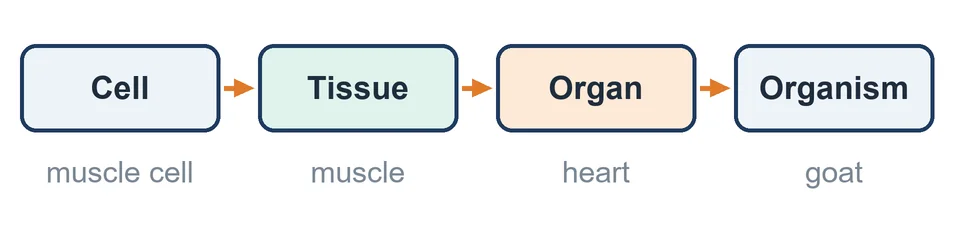

# Cells: the building blocks of life

## Think first

A house is built from bricks. What do you think a goat or a maize plant is built from?

## The cell

All living things are made of **cells**. The cell is the **basic unit** of every living organism. Cells are the building blocks of life, just as bricks are the building blocks of a house.

Cells are made of substances such as water, proteins, carbohydrates and fats.

## One cell or many cells

- Some organisms are made of only **one cell**. They are called **unicellular** organisms. "Uni" means one. Examples: bacteria, amoeba, yeast.
- Other organisms are made of **many cells**. They are called **multicellular** organisms. "Multi" means many. Examples: humans, goats, maize plants, trees.

Your own body has a huge number of cells, far too many to count.

## Seeing cells

Most cells are too small to see with the naked eye. Scientists use a **microscope** to see them.

- A **light microscope** uses light and lenses. It is the kind found in a school laboratory. It shows the shape of cells and their larger parts.
- An **electron microscope** is much more powerful. It shows very small structures that a light microscope cannot show.

## From cells to a whole organism

In multicellular organisms, cells work together in levels.

- Cells of the same kind form a **tissue**.
- Different tissues form an **organ**, such as the heart or a leaf.
- Organs work together in the whole **organism**.

So the order from smallest to largest is: cell, tissue, organ, organism.

## Example

Is a bacterium unicellular or multicellular?

- A bacterium is made of only one cell.
- So it is **unicellular**.

## Try it

- Is a mango tree unicellular or multicellular?
- Put these in order from smallest to largest: organ, cell, organism, tissue.

Check your answers: multicellular. Then cell, tissue, organ, organism.

## Think back

Why can you not see the cells of your own skin when you look at your hand?
