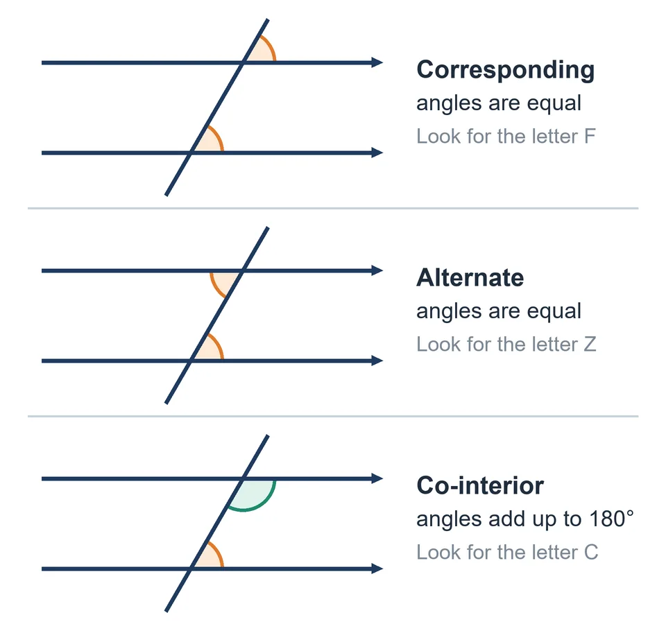
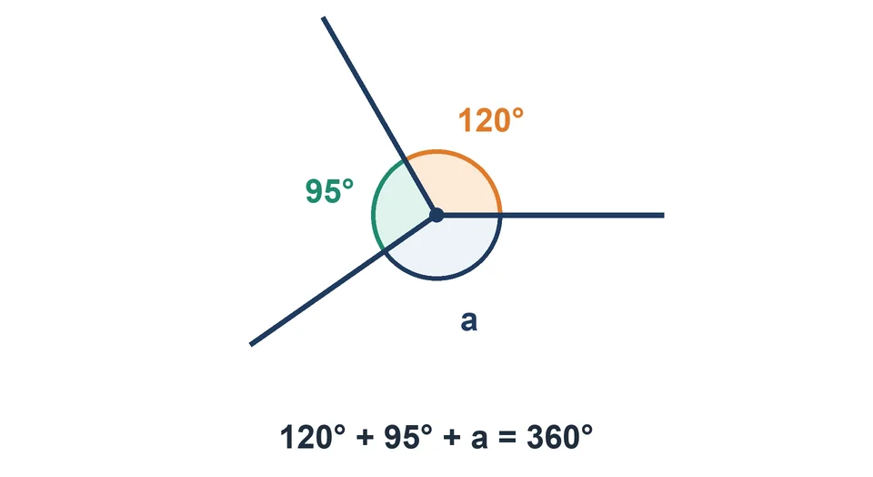

# Angle facts: straight lines, points and parallel lines

## Think first

Two roads cross each other. If you know one of the four angles, can you find the other three without measuring?

## Three facts about meeting lines

- **Angles on a straight line** add up to **180°**. Two angles that add up to 180° are called supplementary angles.
- **Angles at a point** add up to **360°**.
- **Vertically opposite angles** are **equal**. These are the angles that face each other when two straight lines cross.

## Three facts about parallel lines

A line that crosses two parallel lines is called a **transversal**.

- **Corresponding angles** are equal. They are in the same position at each crossing. Look for the letter F.
- **Alternate angles** are equal. They are between the parallel lines, on opposite sides of the transversal. Look for the letter Z.
- **Co-interior angles** add up to **180°**. They are between the parallel lines, on the same side of the transversal. Look for the letter C.

## Always give a reason

In geometry you write the fact you used, in brackets, next to each step.

## Example one

Three angles meet at a point: 120°, 95° and a. Find a.

- 120 + 95 + a = 360 (angles at a point)
- 215 + a = 360
- a = 360 - 215 = 145°

## Example two

Two angles on a straight line are 2x and x. Find x.

- 2x + x = 180 (angles on a straight line)
- 3x = 180
- x = 60°
- So the two angles are 120° and 60°.

## Try it

- Two co-interior angles are 112° and y. Find y. Hint: they add up to 180.
- Two straight lines cross. One angle is 72°. Find the angle next to it. Hint: the two are on a straight line.

Check your answers: 68° and 108°.

## Think back

Which fact do you find hardest to remember? Write it down once more.
