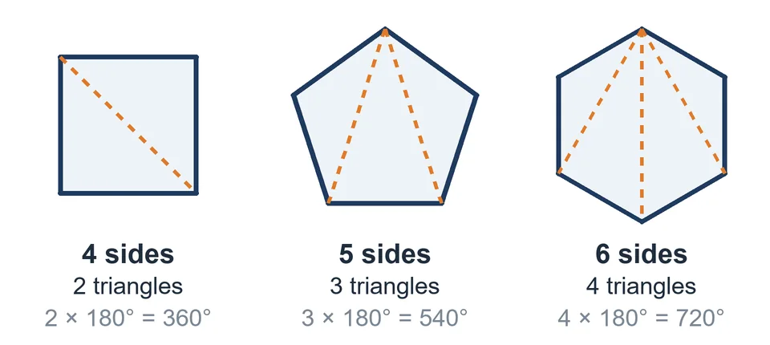

# Angles in polygons

## Think first

A triangle has three angles that add up to 180°. What do you think the four angles of a rectangle add up to?

## Polygons

A **polygon** is a closed shape with straight sides.

- 3 sides: triangle
- 4 sides: quadrilateral
- 5 sides: pentagon
- 6 sides: hexagon
- 8 sides: octagon

## Sum of the interior angles

The **interior angles** are the angles inside the polygon. For a polygon with n sides:

**Sum of interior angles = (n - 2) × 180°**

Why? From one corner you can cut any polygon into triangles. You always get 2 fewer triangles than sides, and each triangle has 180°.

- Triangle: (3 - 2) × 180 = 180°
- Quadrilateral: (4 - 2) × 180 = 360°
- Pentagon: (5 - 2) × 180 = 540°
- Hexagon: (6 - 2) × 180 = 720°

## Sum of the exterior angles

An **exterior angle** is made when you extend one side of the polygon. The exterior angles of **any** polygon add up to **360°**.

## Regular polygons

A **regular polygon** has all sides equal and all angles equal.

- Each interior angle = sum of interior angles ÷ n
- Each exterior angle = 360° ÷ n

For a regular hexagon: each interior angle is 720 ÷ 6 = 120°, and each exterior angle is 360 ÷ 6 = 60°. Notice that 120 + 60 = 180, because the two angles sit on a straight line.

## Example

A quadrilateral has angles of 90°, 85° and 110°. Find the fourth angle.

- The sum must be 360°.
- 90 + 85 + 110 = 285
- 360 - 285 = 75°

## Try it

- Find the sum of the interior angles of an octagon. Hint: n is 8.
- Find each interior angle of a regular pentagon. Hint: find the sum first, then divide by 5.

Check your answers: 1,080° and 108°.

## Think back

Why do you subtract 2 from the number of sides? Explain it in your own words.
