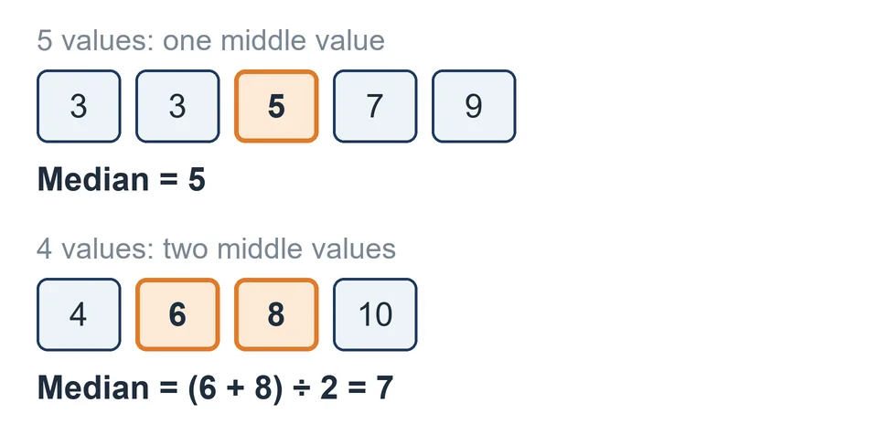

# Median and mode

## Think first

A shop sells shoes in sizes 38, 39, 40 and 41. Which fact helps the shopkeeper more: the average size, or the size most people buy?

## The mode

The **mode** is the value that appears **most often**.

- A set of data can have one mode.
- It can have more than one mode, when two values tie for most often.
- It can have no mode, when every value appears once.

## The median

The **median** is the **middle value** when the data is arranged in order.

- First, arrange the values from smallest to largest. This step is easy to forget.
- Then, find the middle.

If the number of values is **odd**, there is one middle value. That is the median.

If the number of values is **even**, there are two middle values. The median is the mean of those two: add them and divide by 2.

## Example one: odd number of values

Data: 7, 3, 9, 5, 3

- In order: 3, 3, 5, 7, 9
- There are 5 values, so the third one is the middle.
- Median = 5
- Mode = 3, because it appears twice.

## Example two: even number of values

Data: 4, 10, 6, 8

- In order: 4, 6, 8, 10
- The two middle values are 6 and 8.
- Median = (6 + 8) ÷ 2 = 7

## Which average should you use?

- The **mean** uses every value. One very big or very small value can pull it away from the rest.
- The **median** is not pulled by one extreme value.
- The **mode** tells you the most common value. It is the one a shopkeeper needs when deciding what to stock.

## Try it

Data: 12, 15, 11, 15, 20, 9

- Find the mode.
- Find the median. Hint: put the six values in order first, then use the two in the middle.

Check your answers: the mode is 15 and the median is 13.5.

## Think back

What is the first step in finding the median? Say it out loud.
